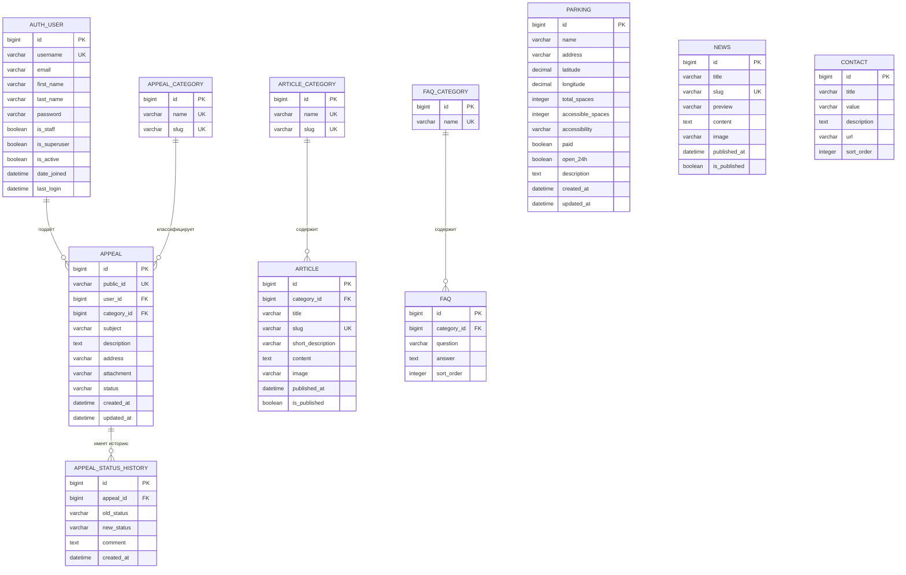

# Полная схема базы данных «ПравоСПб»

Документ описывает текущую структуру Django ORM. Схема рассчитана на SQLite в локальной разработке и PostgreSQL в production.

## 1. ER-диаграмма

Скопируйте блок ниже в редактор с поддержкой Mermaid или откройте файл на GitHub — диаграмма отобразится автоматически.



## 2. Таблицы прикладной части

### `auth_user` — пользователи Django

Стандартная таблица Django-аутентификации. В проекте email пользователя записывается также в поле `username` и используется как логин.

| Поле | Тип | Ограничения | Назначение |
|---|---|---|---|
| `id` | BIGINT | PK | Идентификатор |
| `username` | VARCHAR(150) | UNIQUE, NOT NULL | Логин пользователя, обычно email |
| `email` | VARCHAR(254) | NULL | Электронная почта |
| `first_name` | VARCHAR(150) | NULL | Имя |
| `last_name` | VARCHAR(150) | NULL | Фамилия, стандартное поле Django |
| `password` | VARCHAR(128) | NOT NULL | Хэш пароля |
| `is_staff` | BOOLEAN | NOT NULL | Доступ к кабинету сотрудника и Admin |
| `is_superuser` | BOOLEAN | NOT NULL | Полные права Django Admin |
| `is_active` | BOOLEAN | NOT NULL | Активен ли пользователь |
| `date_joined` | DATETIME | NOT NULL | Дата регистрации |
| `last_login` | DATETIME | NULL | Последний вход |

### `appeals_appealcategory` — категории обращений

| Поле | Тип | Ограничения |
|---|---|---|
| `id` | BIGINT | PK |
| `name` | VARCHAR(120) | UNIQUE, NOT NULL |
| `slug` | VARCHAR(130) | UNIQUE, NOT NULL |

Категории: доступная среда, транспорт, парковка, социальная защита, здравоохранение, образование, жилищные вопросы, нарушение прав, другое.

### `appeals_appeal` — обращения граждан

| Поле | Тип | Ограничения / связь |
|---|---|---|
| `id` | BIGINT | PK |
| `public_id` | VARCHAR(20) | UNIQUE, NOT NULL; формат `SPB-ГОД-000001` |
| `user_id` | BIGINT | FK → `auth_user.id`, CASCADE |
| `category_id` | BIGINT | FK → `appeals_appealcategory.id`, PROTECT |
| `subject` | VARCHAR(200) | NOT NULL |
| `description` | TEXT | NOT NULL |
| `address` | VARCHAR(300) | Может быть пустым |
| `attachment` | VARCHAR(100) | Файл в `media/appeals/ГОД/МЕСЯЦ/` |
| `status` | VARCHAR(20) | Индекс; по умолчанию `new` |
| `created_at` | DATETIME | Индекс, автоматически |
| `updated_at` | DATETIME | Автоматически |

Возможные статусы: `new`, `accepted`, `in_progress`, `info`, `resolved`, `closed`.

### `appeals_appealstatushistory` — история статусов

| Поле | Тип | Ограничения / связь |
|---|---|---|
| `id` | BIGINT | PK |
| `appeal_id` | BIGINT | FK → `appeals_appeal.id`, CASCADE |
| `old_status` | VARCHAR(20) | Может быть пустым |
| `new_status` | VARCHAR(20) | NOT NULL |
| `comment` | TEXT | Может быть пустым |
| `created_at` | DATETIME | Автоматически |

### `parking_parking` — доступные парковки

| Поле | Тип | Ограничения / назначение |
|---|---|---|
| `id` | BIGINT | PK |
| `name` | VARCHAR(180) | Название |
| `address` | VARCHAR(300) | Адрес |
| `latitude` | DECIMAL(9,6) | Широта |
| `longitude` | DECIMAL(9,6) | Долгота |
| `total_spaces` | INTEGER | Всего мест, по умолчанию 0 |
| `accessible_spaces` | INTEGER | Специальные места, по умолчанию 0 |
| `accessibility` | VARCHAR(250) | Описание доступности |
| `paid` | BOOLEAN | Платная парковка |
| `open_24h` | BOOLEAN | Круглосуточная |
| `description` | TEXT | Подробное описание |
| `created_at` | DATETIME | Автоматически |
| `updated_at` | DATETIME | Автоматически |

Индексы: `(latitude, longitude)` и `(paid, open_24h)`.

### `content_articlecategory` — категории статей

| Поле | Тип | Ограничения |
|---|---|---|
| `id` | BIGINT | PK |
| `name` | VARCHAR(150) | UNIQUE, NOT NULL |
| `slug` | VARCHAR(50) | UNIQUE, NOT NULL |

### `content_article` — статьи о правах

| Поле | Тип | Ограничения / связь |
|---|---|---|
| `id` | BIGINT | PK |
| `category_id` | BIGINT | FK → `content_articlecategory.id`, PROTECT |
| `title` | VARCHAR(220) | NOT NULL |
| `slug` | VARCHAR(50) | UNIQUE, NOT NULL |
| `short_description` | VARCHAR(400) | Краткое описание |
| `content` | TEXT | Полный текст |
| `image` | VARCHAR(100) | Файл в `media/articles/` |
| `published_at` | DATETIME | Может быть NULL |
| `is_published` | BOOLEAN | По умолчанию TRUE |

### `content_news` — новости

| Поле | Тип | Ограничения |
|---|---|---|
| `id` | BIGINT | PK |
| `title` | VARCHAR(220) | NOT NULL |
| `slug` | VARCHAR(50) | UNIQUE, NOT NULL |
| `preview` | VARCHAR(400) | Анонс |
| `content` | TEXT | Полный текст |
| `image` | VARCHAR(100) | Файл в `media/news/` |
| `published_at` | DATETIME | Может быть NULL |
| `is_published` | BOOLEAN | По умолчанию TRUE |

### `content_faqcategory` — категории FAQ

| Поле | Тип | Ограничения |
|---|---|---|
| `id` | BIGINT | PK |
| `name` | VARCHAR(150) | UNIQUE, NOT NULL |

### `content_faq` — вопросы и ответы

| Поле | Тип | Ограничения / связь |
|---|---|---|
| `id` | BIGINT | PK |
| `category_id` | BIGINT | FK → `content_faqcategory.id`, CASCADE |
| `question` | VARCHAR(300) | NOT NULL |
| `answer` | TEXT | NOT NULL |
| `sort_order` | INTEGER | По умолчанию 0 |

### `content_contact` — контакты

| Поле | Тип | Ограничения |
|---|---|---|
| `id` | BIGINT | PK |
| `title` | VARCHAR(160) | Заголовок |
| `value` | VARCHAR(300) | Телефон, email или адрес |
| `description` | TEXT | Описание |
| `url` | VARCHAR(200) | Необязательная ссылка |
| `sort_order` | INTEGER | По умолчанию 0 |

## 3. Системные таблицы Django

Кроме прикладных таблиц Django создаёт системные:

| Таблица | Назначение |
|---|---|
| `django_migrations` | Выполненные миграции |
| `django_content_type` | Типы моделей Django |
| `auth_group` | Группы пользователей |
| `auth_permission` | Разрешения |
| `auth_group_permissions` | Связь групп и разрешений |
| `auth_user_groups` | Связь пользователей и групп |
| `auth_user_user_permissions` | Индивидуальные разрешения пользователей |
| `django_admin_log` | Журнал действий в Admin |
| `django_session` | Сессии авторизованных пользователей |

## 4. Правила удаления связей

| Связь | Поведение |
|---|---|
| Пользователь → обращения | `CASCADE`: удаление пользователя удаляет его обращения |
| Категория → обращения | `PROTECT`: категорию нельзя удалить, если есть обращения |
| Обращение → история | `CASCADE`: история удаляется вместе с обращением |
| Категория статьи → статьи | `PROTECT`: категорию нельзя удалить, если есть статьи |
| Категория FAQ → вопросы | `CASCADE`: вопросы удаляются вместе с категорией |

## 5. Команды для проверки схемы

```powershell
python manage.py showmigrations
python manage.py sqlmigrate appeals 0001
python manage.py sqlmigrate content 0001
python manage.py sqlmigrate parking 0001
python manage.py migrate
```

Для PostgreSQL в production схема создаётся той же командой `migrate`.
