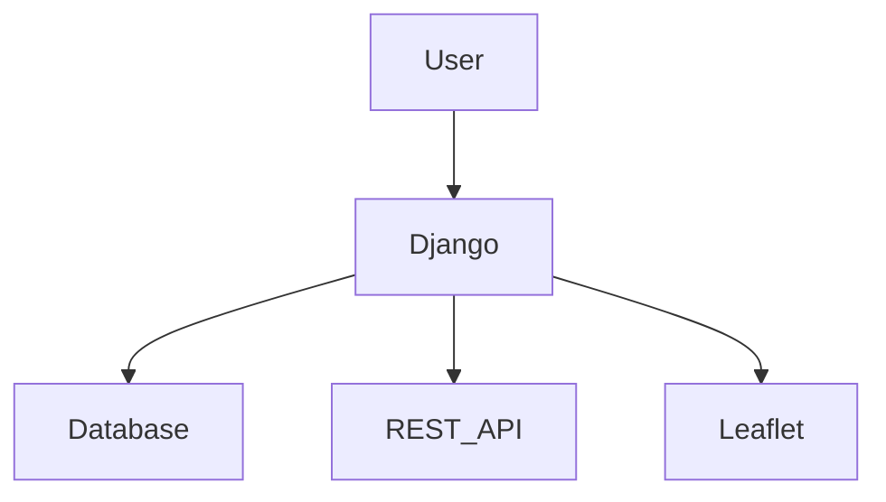
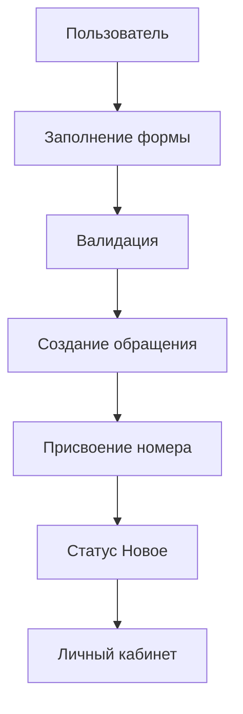
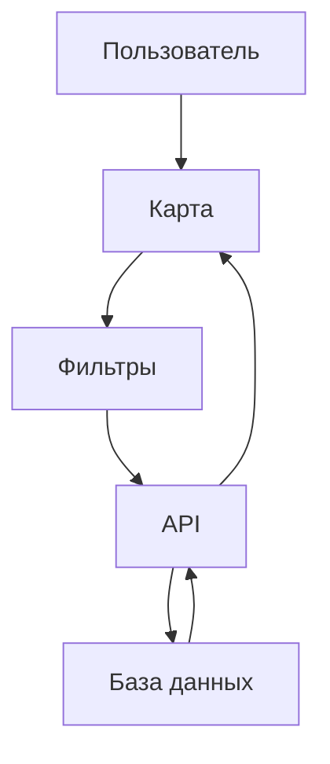
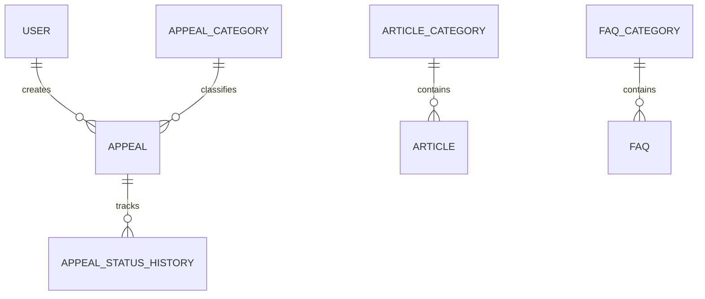

# Проектно-семестровая работа: «ПравоСПб»

## 1. Введение
Актуальность проекта связана с необходимостью понятного доступа к информации о правах и городской доступности. Цель — создать учебный цифровой сервис для жителей Санкт-Петербурга. Задачи: разработать базу материалов, карту парковок, систему обращений, личный кабинет, API и доступный интерфейс. Объект — цифровая поддержка граждан; предмет — веб-сервис взаимодействия с информацией и обращениями.

## 2. Анализ предметной области
Маломобильные граждане сталкиваются с барьерами городской среды и разрозненностью сведений. Единый сервис помогает найти материал, сообщить о проблеме и проверить статус обращения.

## 3. Постановка задачи
Разработать понятное адаптивное приложение без чат-ботов и AI, с реальной БД и административным управлением.

## 4. Выбор технологий
Python и Django дают понятную серверную архитектуру и ORM; PostgreSQL предназначен для production, SQLite — для учебной разработки; DRF предоставляет API, Bootstrap — адаптивную сетку, Leaflet/OpenStreetMap — карту, Docker — воспроизводимый запуск, Vercel — serverless-развёртывание.

## 5. Проектирование системы

## 6. Проектирование базы данных
Пользователь связан с обращениями; обращение связано с категорией и историей статусов. Парковка хранит координаты и признаки доступности. Article, News, FAQ и Contact образуют информационные разделы.

## 7. Система обращений

## 8. Карта парковок
Leaflet показывает координатные маркеры, backend-фильтры позволяют выбрать доступные, платные, бесплатные и круглосуточные места.

## 9–12. Информационные разделы, accessibility, API, admin
Реализованы статьи, новости с поиском, FAQ с раскрывающимися ответами, контакты, toolbar слабовидящих, Swagger/OpenAPI и стандартная Django Admin.

## 13–14. Docker и развёртывание
Compose содержит web и PostgreSQL. Vercel-конфигурация рассчитана на WSGI, но требует внешней PostgreSQL и внешнего хранения загружаемых файлов.

## 15. Тестирование
| № | Действие | Ожидаемый результат | Фактический результат |
|---|---|---|---|
| 1 | `python manage.py check` | Системных ошибок нет | Выполнено локально |
| 2 | `python manage.py test` | Тесты проходят | Выполнено локально |
| 3 | Создание обращения | Номер и история созданы | Выполнено локально |

## 16. Безопасность
Секреты вынесены в `.env`, формы защищены CSRF, обращения ограничены владельцем/администратором, ORM предотвращает SQL-инъекции, размер вложения ограничен 5 МБ. Для production включаются secure cookies.

## 17. Заключение
Создан рабочий учебный прототип социального сервиса с расширяемой архитектурой.

## 18. Перспективы
Мобильное приложение, Telegram-бот, AI-помощник, реальные городские API, push-уведомления и интеграция с госуслугами сознательно не реализованы в текущей версии.

## 19. Источники
Документация Django: https://docs.djangoproject.com/; DRF: https://www.django-rest-framework.org/; Leaflet: https://leafletjs.com/; OpenStreetMap: https://www.openstreetmap.org/; Bootstrap: https://getbootstrap.com/; Vercel Python: https://vercel.com/docs/functions/runtimes/python.

## ER-диаграмма

